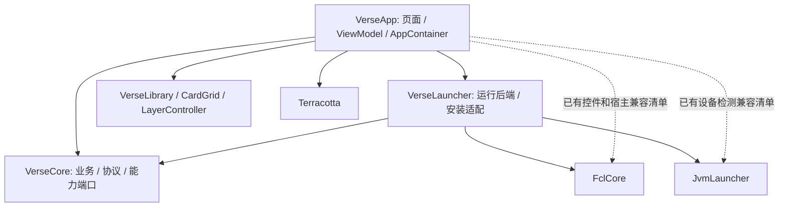
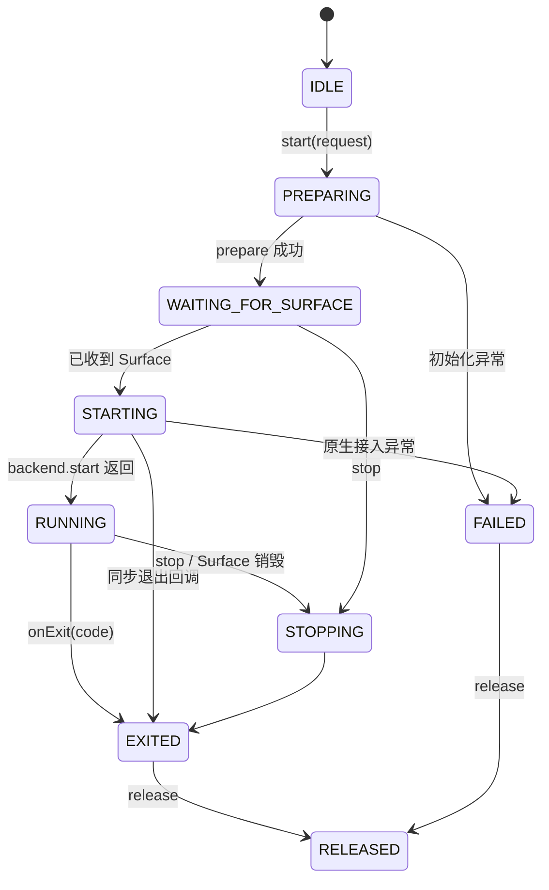

# 架构与兼容边界

## 运行入口与进程

当前受维护的游戏主链为页面启动请求 → `LaunchIntentCodec` → `GameActivity` → `GameSession` → `FclGameRuntimeBackend` → `DefaultLauncher` → FCL/JNI 桥。普通启动、快捷启动和冷重启共用 Core 的 `LaunchRequest` 协议。旧 `GameService`、`MinecraftLauncher` 及其独占参数解析、环境和窗口辅助类已经移除。

游戏 JVM 仍遵循既有进程内单次初始化约束。游戏退出后的冷重启、Surface 销毁时停止游戏、`:crash` 崩溃页和 `:jvm` 安装处理器进程分工保持不变。架构整理不改变 JNI 包名、类名、方法签名或原生初始化顺序。

## 模块职责

`VerseApp` 负责界面、Android 生命周期、权限和依赖装配；`VerseCore` 定义业务数据和外部能力端口；`VerseLauncher` 实现启动、FCL 安装及运行时适配。原生实现继续位于 `JvmLauncher`、`FclCore` 和 `Terracotta`。

历史第三方兼容包可以保留必要的底层接口引用，新增业务代码通过端口调用。兼容标识、用户配置键、版本目录布局及插件协议均属于兼容契约。

`VerseCore` 的 Gradle 依赖和生产源码均不引用 FCL。`LoaderInstallBackend`、`ModpackInstallBackend` 使用 Verse 的数据类型和进度事件；实现位于 Launcher 的 `adapter/install`。依赖装配采用 `AppContainer` 和手动 ViewModel Factory，不引入注入框架。

`FclLaunchPreparation` 封装宿主的预检和 FCL 参数转换，`FclRenderSettings` 适配现有 MenuSetting。`GameLaunchOrchestrator` 只把会话状态映射为窗口展示、退出和错误提示；原生初始化、JVM 停止和桥接释放由运行后端管理。

## 配置和生命周期

全局设置与版本独立设置沿用当前各字段的优先级，Intent 解码保留原有键与默认值。账号令牌只作为启动输入传递，不写入架构诊断报告。

仓库和跨页面安装任务由应用作用域持有；ViewModel 由对应 Activity 的 ViewModelStore 管理；游戏资源由单次会话持有。停止和释放必须幂等，迟到回调不得重新激活已结束的会话。

| 所有者 | 持有内容 | 结束条件 |
| --- | --- | --- |
| `VerseApplication` / `AppContainer` | 账号仓库、下载中心、版本安装、按资源隔离的整合包/资源安装、运行时安装 | 应用进程结束；单次任务结束后释放执行资源 |
| Activity `ViewModelStore` | 设置编辑状态、账号状态、版本列表、资源列表、模组详情与加载任务 | Activity 最终销毁时 `onCleared`，配置重建复用 Store |
| `GameSession` | 一次启动、等待 Surface、运行后端及其协程 | 显式停止、Surface 销毁、退出或释放 |
| Composable | 选择器、筛选、弹窗和动画等短暂展示状态 | 离开组合 |

本轮迁移的应用级安装任务不会捕获 Activity 或 Composable 完成回调。通知权限由应用发送事件，当前 RESUMED 的宿主通过 Activity Result API 请求。不存在全局前台 Activity，也不自行缓存 ViewModel 单例。

### 游戏会话

任意阶段均可释放。重复启动被拒绝，停止和释放各至多执行一次；已退出或释放后的 Surface/退出回调被忽略。原生后端在同一临界区检查停止标记并执行 `bridge.execute`，阻止取消后再次启动 JVM。退出后的重新启动继续使用原有 Alarm + 新进程方式，不复用已结束的 JVM。

### 安装与下载

`InstallationSnapshot` 在入口捕获根目录和下载源，`InstallationPaths` 解析既有目录布局，`InstallationPlan` 决定原版/继承版本落盘关系。安装、补全和资源安装显式使用这些目标；资源下载的临时缓存文件按任务区分。

`GameInstaller` 保留业务步骤，`InstallDownloadExecutor` 负责 OkHttp 文件传输，`RepairDownloadExecutor` 保留补全流程的 URLConnection 参数，`SmartDownloadClient` 和 `MirrorSourceManager` 继续负责原有多源策略。`DownloadAggregator` 按任务聚合字节，重试不重复累计已经上报的部分。

`VersionInstallCoordinator` 拒绝重叠启动，取消后等待写入任务结束再清理，只处理开始前不存在的目标版本目录；既有基础版本、共享资源和其他目录保留。`InstallationLease` 在不同入口之间互斥占用版本目录，结束后幂等释放。每条整合包任务持有独立执行器及进度监听集合，前一执行器未结束时不能重试。已有同名版本要求重新命名，不再按“不是整合包”推断它可以删除。

## 维护约束与验证

运行 `python tools/architecture_check.py` 检查模块循环、Core 第三方依赖、白名单外 JNI/第三方调用、旧启动链和全局页面对象回流。清单为 [architecture-compatibility.json](../tools/architecture-compatibility.json)，逐文件记录具体符号及理由；新增例外必须单独审查，不能整体重建清单绕过检查。

CI 在 PR 和 main 推送上运行 Python 检查、Core/Launcher/App 本地测试及 ARM64 调试构建。保留的格式和接口详见 [兼容契约](COMPATIBILITY.md)，实测结果与设备验收状态见 [验证报告](ARCHITECTURE_VALIDATION.md)。

## 漂移基线核查

漂移工具对 Java、Kotlin、XML 等文本统一按 LF 计算 SHA-256，对二进制保持原始字节。原有 18 处纯换行符差异不代表源码行为改变。

另两项原有差异已逐项阅读：`FCLBridge.java` 在启动线程前同时设置 native 与 Java 桥引用；`NeoForgeOldInstallTask.java` 使用宿主 Context、处理器锁和独立套接字端口执行安装处理器。这些均为当前已存在的宿主集成行为，本轮仅记录并更新基线，不修改其实现。新的基线格式为 schemaVersion 2，文本规范为 LF。
